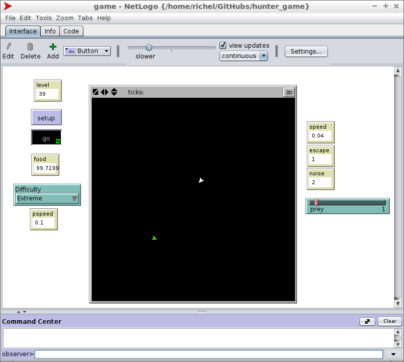

# Hunter Game

Hunter Game is one of [Richèl Bilderbeek's games](https://richelbilderbeek.github.io/games/).

A NetLogo (v. 5.3.1) game by Rolf F. Storms.

This game was programmed for a TRES event called 'fun programming', in which one combines beer and programming. Rolf was so enthusiastic, he wrote this game a day in advance.

- [The NetLogo game file](https://github.com/richelbilderbeek/hunter_game/blob/master/game.nlogo)

## Manual

- Click 'Setup'
- Click 'Go'
- Click on the prey to hunt it

## Screenshots

## Links

- [Source code](https://github.com/richelbilderbeek/hunter_game)
